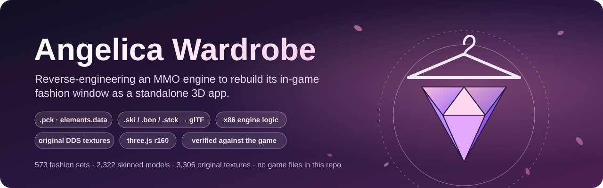
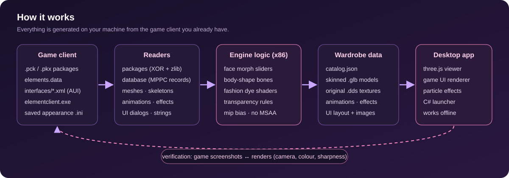

<p align="center">
  
</p>

<p align="center">
  
  
  
  
  
  
</p>

<p align="center">
  <b>English</b> · <a href="README.vi.md">Tiếng Việt</a> ·
  <a href="#what-it-does">Features</a> · <a href="#how-it-works">How it works</a> ·
  <a href="#running-it-with-your-own-client">Run it</a> · <a href="docs/FORMATS.md">Format notes</a>
</p>

Tools that read the data files of the **Thế Giới Hoàn Mỹ** client (the Vietnamese release of Perfect World,
Angelica engine) and rebuild its in-game fashion collection window ("Thu thập") as a standalone 3D app:
every fashion set on the player's own character, with the game's UI, dyes, effects and animations.

> [!NOTE]
> **No game content is included.** This repository only contains code. Models, textures, UI images and game
> data belong to their publisher; the tools generate them locally from a client you already have.

## What it does

<table>
  <tr>
    <td width="50%" valign="top">
      <h3>🔍 Reads undocumented formats</h3>
      All reverse engineered: <code>.pck/.pkx</code> packages, <code>elements.data</code> (per-record MPPC
      compression), <code>.ski</code> meshes, <code>.bon</code> skeletons, <code>.stck</code> animations,
      <code>.gfx</code> effects, <code>.mtl</code> materials, AUI dialogs, <code>.stf</code> strings.
    </td>
    <td width="50%" valign="top">
      <h3>🧊 Converts to glTF</h3>
      2,300+ skinned fashion models exported to <code>.glb</code>, keeping the game's own DDS textures so the
      browser samples the same DXT blocks and mipmaps as the game.
    </td>
  </tr>
  <tr>
    <td valign="top">
      <h3>🧠 Re-implements engine logic</h3>
      Found in the client's x86 code: the character-creator face morph, the body-shape bone rules, the fashion
      shaders (gamma-space dye masks, channel maps, reflection, transparency).
    </td>
    <td valign="top">
      <h3>🪟 Rebuilds the game window</h3>
      From the game's own UI files: positions, frames, fonts, scrolling, with real collection data —
      315 female / 258 male sets in 6 groups, rarity, default colours, pets, effects.
    </td>
  </tr>
  <tr>
    <td valign="top">
      <h3>📏 Checks itself against the game</h3>
      Game screenshots vs renders: camera fitted with Nelder–Mead on edge correlation, lights on colour error,
      texture sharpness on high-frequency energy; body-shape values confirmed on the running client.
    </td>
    <td valign="top">
      <h3>🖥️ Ships as a desktop app</h3>
      A tiny C# launcher starts a local server and opens the page in its own window. Fully offline.
    </td>
  </tr>
</table>

## How it works

<p align="center"></p>

## Layout

```
tools/
  pck_reader.py elements_reader.py game_data.py      game packages and database
  ski_reader.py bon_reader.py stck_reader.py         meshes, skeletons, animations
  gfx_reader.py mtl_reader.py                        effects, materials
  extract_fashion.py fashion_classify.py vn_names.py find and extract the fashion assets
  ski_to_glb.py anim_export.py skinning.py           conversion to glTF
  build_sets.py build_fx.py build_ui.py              sets, effects, UI layout
  face_morph.py body_shape.py                        engine logic re-implemented from the executable
  build_wardrobe.py deploy_viewer.py                 wardrobe data + page deployment
  check_wardrobe.py check_glb.py prune_wardrobe.py   audits
  tghm_paths.py                                      where the client and the output are
  viewer/      tu_do.html / tu_do.js (wardrobe), aui.js (game UI renderer), fx.js (particles),
               xem_3d.html (model browser), server.ps1, launcher/ (C# app window)
  _ref/        reverse-engineering and comparison helpers (disassembly, pack search, image metrics)
docs/FORMATS.md  notes on the file formats and engine behaviour
```

## Running it with your own client

Requirements: Windows, Python 3.11+, `pip install -r requirements.txt`, a TGHM / Perfect World client.

1. Put `tools/` inside the client folder, or create `tools/config.local.json`:
   `{"game": "D:\\Games\\TGHM Online", "data": "E:\\TGHM_Data"}` (output folder, several GB).
2. Extract the fashion assets: `py tools/extract_fashion.py`
3. Export the game UI dialogs: `py tools/build_ui.py`
4. Build the wardrobe (models, textures, catalog): `py tools/build_wardrobe.py`
5. Copy the pages and fetch three.js: `py tools/deploy_viewer.py`, then
   `powershell -File tools/viewer/get_three.ps1 -Out <data>\3D`
6. Open `<data>\3D\XEM_TU_DO.bat`, or build the app with `tools/viewer/launcher/build.ps1`.

The sample character is the newest appearance saved by the game's character creator
(`element\userdata\character\customize`).

## How it was built

Built as an AI-assisted project with Claude Code: the agent did most of the reverse engineering, code and
image comparisons; I drove the goals, played the game to provide reference screenshots, checked the results
against the client and decided what "identical to the game" meant at each step.

## License

Code: MIT (see [`LICENSE`](LICENSE)). Game data, models, textures and UI art are not covered and not distributed.
